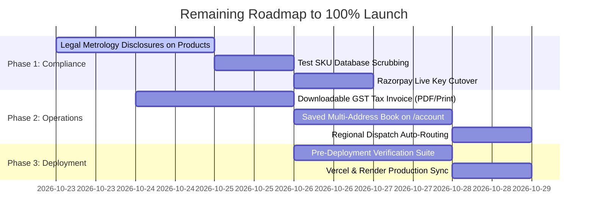
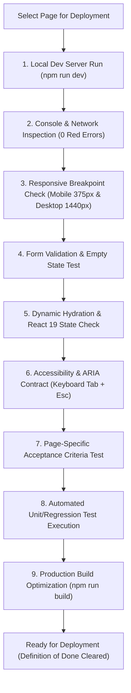

# Pending Tasks & Pre-Deployment Page Verification Plan

> **For agentic workers:** REQUIRED SUB-SKILL: Use superpowers:subagent-driven-development (recommended) or superpowers:executing-plans to implement this plan task-by-task. Steps use checkbox (`- [ ]`) syntax for tracking.

**Goal:** Provide an exhaustive inventory of all remaining tasks for Sri Ram & Co e-commerce, and establish a rigid pre-deployment page verification protocol adhering to the project's Definition of Done and Quality Constraints.

**Architecture:** Full-stack audit across Next.js 15 App Router storefront pages and Express/Node.js backend services. Incorporates unit/integration tests (`tsx --test`), build optimization gates, and runtime DOM/network verification.

**Tech Stack:** Next.js 15.5.27, React 19, TypeScript 5.7, Node.js 22+, Express, MongoDB Atlas, Razorpay, Zoho Mail, Helmet, CSS Modules.

**Spec:** [`CONSTRAINTS.md`](file:///c:/Users/Silvest%20AJ/Documents/project-4/CONSTRAINTS.md) and [`AGENTS.md`](file:///c:/Users/Silvest%20AJ/Documents/project-4/AGENTS.md)

---

## Global Constraints

* **Floor Enforcement**: Zero `@ts-ignore`, zero skipped/deleted tests, zero unhandled stubs.
* **Backend Gate**: ≥ 125 server tests passing (`npm test --prefix server`).
* **Frontend Gate**: ≥ 57 client tests passing (`npm test --prefix client`).
* **Production Build Gate**: Zero errors across all 37 static & dynamic Next.js routes (`npm run build --prefix client`).
* **Time Budget**: Fast edit loops must finish in < 30 seconds; full verification runs before claiming completion.

## Review Focus

1. **Unsaved Address Checkout Abandonment**: Customers on `/checkout` having to re-enter physical addresses manually.
2. **Missing Legal Metrology Disclosures**: Risk of non-compliance with statutory Indian e-commerce consumer guidelines.
3. **Ghost Test SKU Accidental Orders**: Risk of customers purchasing test ₹1 or placeholder products.
4. **GST Tax Invoice Compliance**: Legal requirement under GST Act for B2C/B2B tax credit invoices with CGST/SGST splits.
5. **Pre-Deployment Page Broken Links**: 404s, layout shift (CLS), or unhandled edge cases on mobile viewports.

---

## Part 1: Comprehensive Inventory of Pending Tasks

### Pending Tasks Ledger

| Task ID | Component / Area | Description | Priority | Effort |
|---|---|---|:---:|:---:|
| **TASK-01** | **Product Detail (`/product/[slug]`)** | **Statutory Legal Metrology Disclosures**: Standardized manufacturer, country of origin (India), packer, net quantity (1 Unit), and consumer helpline card. | **HIGH** | 1.5 hrs |
| **TASK-02** | **Orders & Billing (`/orders/[id]`)** | **Printable / Downloadable GST Tax Invoice**: Standard A4 invoice with GSTIN (`33ARHPR6139B1ZX`), HSN/SAC code, 9% CGST + 9% SGST breakdown, and authorized signatory. | **HIGH** | 2.5 hrs |
| **TASK-03** | **Customer Account (`/account`)** | **Saved Address Book Management**: Allow customers to save multiple labeled addresses (Home, Work, Other) and select them in 1-click on `/checkout`. | **MEDIUM** | 3.0 hrs |
| **TASK-04** | **Database Catalog Cleanup** | **Scrub Replica & Test SKUs**: Cleanse active MongoDB catalog of test products (e.g. ₹1 dummy products, replica headphones) preserving genuine kitchenware inventory. | **MEDIUM** | 1.0 hr |
| **TASK-05** | **Order Dispatch Routing** | **Pincode Regional Routing**: Automatically assign orders to Trichy Main Hub (`620xxx-622xxx`) vs. Chennai Experience Store (`600xxx`) in admin order view. | **LOW** | 2.0 hrs |
| **TASK-06** | **Payment Gateway Cutover** | **Production Razorpay Activation**: Swap test credentials on Vercel & Render for live merchant keys and production webhook endpoint. | **FINAL GATE** | 0.5 hr |

---

## Part 2: Page-by-Page Pre-Deployment Testing Protocol

Every page in the application must clear the following **10-Point Pre-Deployment Verification Protocol** before deploying to production:

### Page Verification Matrix

| Page Route | Critical Test Scenarios | Verification Method | Pass Criteria |
|---|---|---|---|
| **Home (`/`)** | Hero slider, Featured Products carousel, category pills, WhatsApp CTA | Chrome DevTools + Browser | 0 console warnings, images use WebP/responsive, LCP < 2.5s |
| **Shop (`/shop`)** | Filters (Category, Price range, In-stock), Sort (Price low/high), Pagination | Browser + State Check | URL query sync (`?category=...`), instant filter response, empty state for 0 results |
| **Product Detail (`/product/[slug]`)** | Image gallery zoom, Add to Cart, Buy Now, Quantity controls, Metrology card | Browser + Cart Context | Correct stock disable, cart badge increments, Legal Metrology card visible |
| **Cart (`/cart`)** | Quantity update (+/-), item removal, free delivery threshold progress bar | Browser + LocalStorage | Subtotal arithmetic exact, promo code check, persistent across refresh |
| **Checkout (`/checkout`)** | Phone verification (+91), Pincode (6 digits), Policy consent checkbox, Razorpay modal | Browser + Test Gateway | Validation blocks invalid fields, Razorpay SDK triggers cleanly, zero price tampering |
| **Orders (`/orders`)** | Guest tracking by Ref ID, authenticated order history, **Return Product modal**, Cancel modal | Unit Tests + Browser | 7-day cutoff accurately enforced, status badge reflects state, email alerts fire |
| **Account (`/account`)** | Profile details, order history overview, saved addresses, logout | Auth Flow + JWT | Protected route redirects to `/login` if unauthenticated, token refresh works |
| **Reset Password (`/reset-password`)** | Token validation from URL query, password strength validation, submission | Unit Tests + Browser | Expired tokens show error, successful reset updates password and redirects |
| **Search (`/search`)** | Keyword lookup, query highlight, "No products found" fallback | Browser + Mock queries | Handles ReDoS characters (`[`, `*`, `?`) without crashing, renders matching SKUs |
| **Legal Pages (`/terms`, `/refund-policy`, `/warranty-policy`)** | Legal copy accuracy, store contact info (`+91 93454 03136`, Trichy address) | Visual Audit | Correct GSTIN, correct postal address, links return HTTP 200 |

---

## Part 3: Definition of Done Verification Checklist

Every change or page deployment must strictly clear this checklist:

### 1. Correctness
- [ ] **Acceptance Criteria**: All specific task requirements are verified.
- [ ] **Runtime Execution**: Code executed and verified at runtime (not just compiled).
- [ ] **TDD Coverage**: New behavior covered by tests written before code.
- [ ] **Zero Regressions**: `npm test --prefix server` (≥ 125 tests) and `npm test --prefix client` (≥ 57 tests) pass 100%.
- [ ] **Edge Cases**: Empty states, network failure, out-of-stock items, and invalid inputs handled gracefully.

### 2. Quality
- [ ] **No Suppressions**: Zero `@ts-ignore`, `@ts-nocheck`, or `eslint-disable`.
- [ ] **No Dead Code**: Removed unused variables, commented-out code, and debug `console.log` statements.
- [ ] **Clean Formatting**: Formatted cleanly with proper naming and structure.
- [ ] **Scoped Changes**: Edits confined strictly to the planned deliverable.

### 3. Integration & Compatibility
- [ ] **API Contracts**: REST payloads match between client (`client/src/lib/api.ts`) and server (`server/src/routes/`).
- [ ] **Database Integrity**: Mongoose schema validations enforced with indexes and TTLs.
- [ ] **Backward Compatibility**: Existing database records load cleanly without errors.

### 4. Ship-Readiness
- [ ] **Security**: Inputs sanitized, email headers CRLF-stripped, rate limits active, origin shielded.
- [ ] **Build Verification**: `npm run build --prefix client` and `npm run build --prefix server` exit 0.
- [ ] **Parity Check**: Git branches synced and clean.
